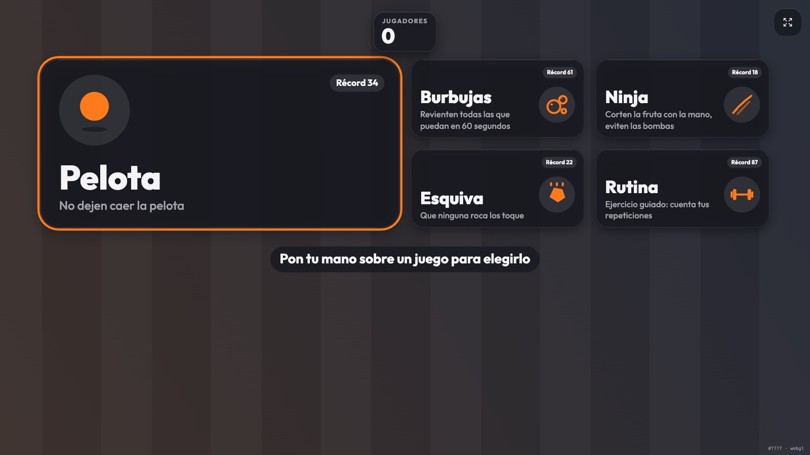
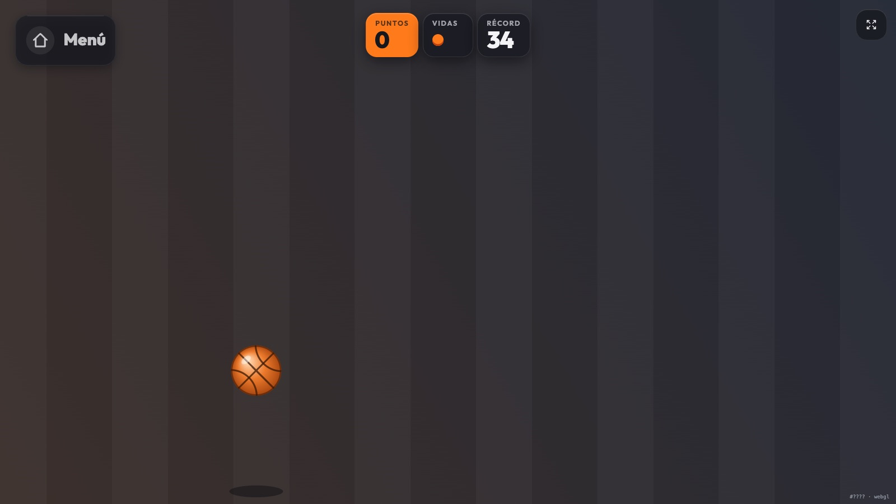
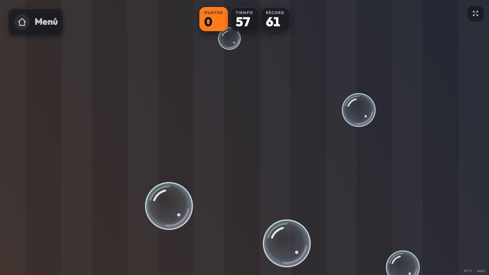
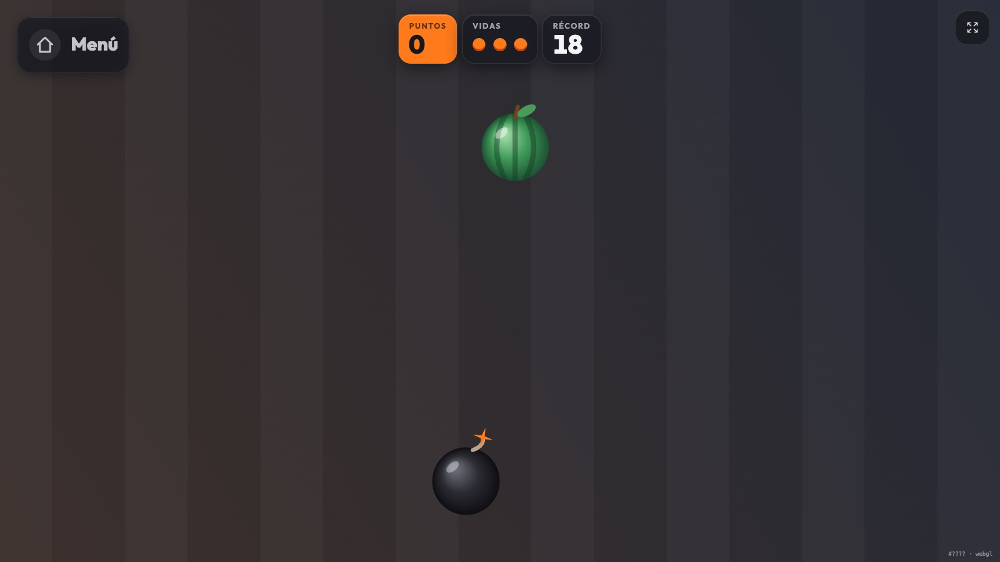
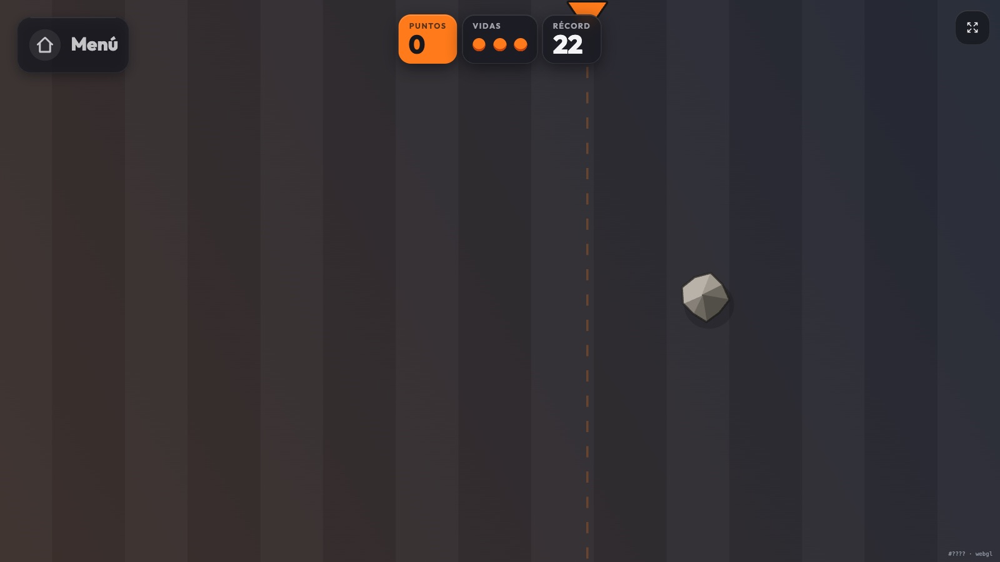
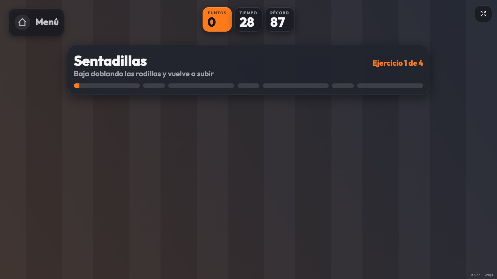
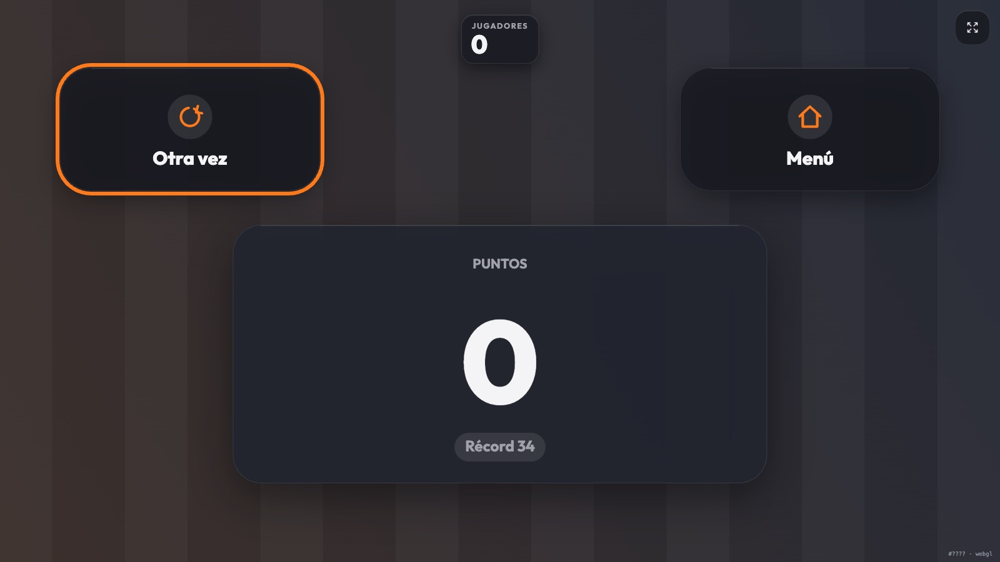

# Game Cam

**Kinect-style party games that run in a browser.** Point a webcam at the room, put the picture on your TV, and play with your whole body. Up to 5 people at once, with no controllers or accounts. The video never leaves your device.

**Play it:** https://game-cam.dev-eliud-trejo.workers.dev



> The UI is in Spanish (the audience this was built for). The code, docs and commit history are in English.

## Games

| | |
|---|---|
|  |  |
| **Pelota (keep-up).** Don't let the ball hit the floor. Bounce it with your head, hands, knees or feet. A fast swing hits harder, and bigger groups get more balls. | **Burbujas (bubbles).** Pop as many bubbles as you can in 60 seconds. Small bubbles are worth more and golden ones are worth 5. |
|  |  |
| **Ninja.** Slice the fruit with fast hand movements and keep your hands away from the bombs. | **Esquiva (dodge).** A marker warns where each rock will fall. Nobody on the team can get hit. |
|  |  |
| **Estatuas (statues).** Dance while the music plays. When it stops, freeze: anyone who moves costs the team a life and gets called out in their color. | **Copia la pose (copy the pose).** A figure shows an arm pose; copy it and hold it for a second. It only uses the upper body, so it works in small rooms. |
| **Rutina (workout).** A guided routine of squats, jumping jacks, high knees and arm raises (arm-only exercises in small rooms). Reps are counted for each person, shown above their head in their color. | **Results.** Each game keeps its own best score. Replay or go back to the menu with your hand. |

All games are co-op: everyone in front of the camera adds to the same score.

## Controls

- **Hand hold:** hold a hand over a tile for about 1 second to pick it. To leave a game, hold the in-game *Menú* tile for 2 seconds, which avoids leaving by accident.
- **Touch or mouse:** tap any tile.
- **TV remote or keyboard:** arrows and Enter to move and select, Esc or Backspace to go back to the menu, `F` for fullscreen, `M` to mute the music.

## How it works

```
camera ──► MoveNet MultiPose (TF.js, WebGL) ──► player tracker ──► game logic ──► canvas
           17 keypoints × up to 5 people         stable ids,         pure step()
           runs async, on-device                 colors, velocities  functions
```

- **Pose detection.** [MoveNet MultiPose Lightning](https://www.tensorflow.org/hub/tutorials/movenet) runs on the GPU through TensorFlow.js. The input size is raised to 512 px so that 5 people across a 16:9 frame still get accurate wrists. MediaPipe Pose was tried first, but it found 0 of 5 people in the same scene.
- **Tracking.** Poses are matched frame to frame by torso position, so each person keeps the same color. Hand velocity is measured between camera frames, not screen frames, so a fast swing really does hit harder.
- **Hands.** The model has no palm keypoint. The palm is estimated by extending the forearm (elbow → wrist) by 35%.
- **Small rooms.** The camera is zoomed out to its widest when it supports zoom. When the screen's shape differs a lot from the camera's (for example a 16:9 webcam on a portrait screen), the full camera picture is shown with bars instead of cropping, and the games are played inside it. Hit areas scale with each person's shoulder width, so someone close to the camera has bigger hands than someone far away.
- **Recovery.** The GPU context can be lost, for example when macOS switches GPUs as you plug in an HDMI TV. When that happens the detector rebuilds itself in about a second instead of silently going blind.
- **Games.** Every mini-game implements one small contract (`start`, `step`, `render`, `status`). `step` is a pure function, so game rules are unit-tested without a browser.
- **Offline PWA.** The model (9.3 MB), the font and every asset are precached by a service worker. After the first visit the app works without a network and can be installed to a phone's home screen.

### Privacy

All detection runs locally in the browser. No video, image or pose data is sent anywhere. The only network requests are for the app's own static files.

## Music

Every screen has background music. Three CC0 tracks from OpenGameArt play by default (credits in [`public/music/LICENSES.md`](public/music/LICENSES.md)). When a track is missing or fails to load, a loop synthesized in the browser with the Web Audio API plays instead, so music works offline either way. Statues stops the music to signal the freeze. Mute with the speaker button or the `M` key; the choice is remembered.

## Getting started

Requirements: Node 20+ and [pnpm](https://pnpm.io) 10.

```bash
pnpm install
pnpm dev        # http://localhost:5173 (camera works on localhost)
pnpm test       # unit tests (vitest)
pnpm build      # type-check + production build in dist/
```

### Playing on a TV

1. Open the app on a laptop, or on a phone that has the app installed.
2. Send the screen to the TV over HDMI, AirPlay or Chromecast.
3. Put the camera at about chest height. From 2–3 m everyone is visible head to toe. In a small room, half a body is enough: when nobody's legs are visible for a second, the app switches to half-body mode and the workout uses arm exercises only (arm raises, side punches, arm openers).

Smart TV browsers rarely allow camera access, so the camera and the processing run on the laptop or phone.

### Installing on a phone

- **Android (Chrome):** menu → *Install app*.
- **iPhone (Safari):** Share → *Add to Home Screen*. iPhone Safari has no fullscreen API for web pages, so the installed app is the way to play without browser bars.

Browsers only allow camera access over HTTPS (or on `localhost`), so the app has to be served once from an HTTPS host. After that it works offline.

## Deploying

The production build is a fully static site. It is deployed to Cloudflare as static assets ([`wrangler.jsonc`](wrangler.jsonc)):

```bash
pnpm deploy     # build + wrangler deploy
```

Any static host with HTTPS also works (GitHub Pages, Netlify, …): upload `dist/`.

## Project structure

```
src/
├── app/         # screen flow (menu → countdown → playing → results), hand-hold zones
├── core/        # MiniGame contract and shared types
├── game/        # ball physics
├── games/       # one file per game (+ games/render/* for drawing) and the registry
├── workout/     # rep detectors (angles with hysteresis), routine schedule
├── pose/        # MoveNet wrapper, body colliders, multi-person tracker
├── render/      # design system (theme, icons), menu, screens, skeleton overlay
├── ui/          # DOM HUD, fullscreen helpers
└── i18n/        # all user-facing text (es.json)
```

### Adding a game

1. Create `src/games/<id>.ts` that exports a `MiniGame<State>` (see [`src/core/types.ts`](src/core/types.ts) and [`keepUp.ts`](src/games/keepUp.ts) for a small example).
2. Add `games.<id>.title` and `games.<id>.description` to [`src/i18n/es.json`](src/i18n/es.json).
3. Register it in [`src/games/registry.ts`](src/games/registry.ts) and map an icon in [`src/render/icons.ts`](src/render/icons.ts).

## Known limitations

- The camera has to see full bodies. Five people need a wide-angle webcam and some floor space.
- Workout reps come from 2D joints. Squats get less accurate when the knees point straight at the camera, and "high knees" can be confused with leaning forward.
- If two people overlap, joints get hidden and that person's count pauses until they are fully visible again.

## Credits

- [MoveNet](https://www.kaggle.com/models/google/movenet) by Google (Apache 2.0), served from this repo for offline use.
- [Outfit](https://fonts.google.com/specimen/Outfit) typeface (SIL Open Font License), via Fontsource.
- Built with [Vite](https://vitejs.dev), [TensorFlow.js](https://www.tensorflow.org/js) and [vite-plugin-pwa](https://vite-pwa-org.netlify.app).

## License

[MIT](LICENSE)
